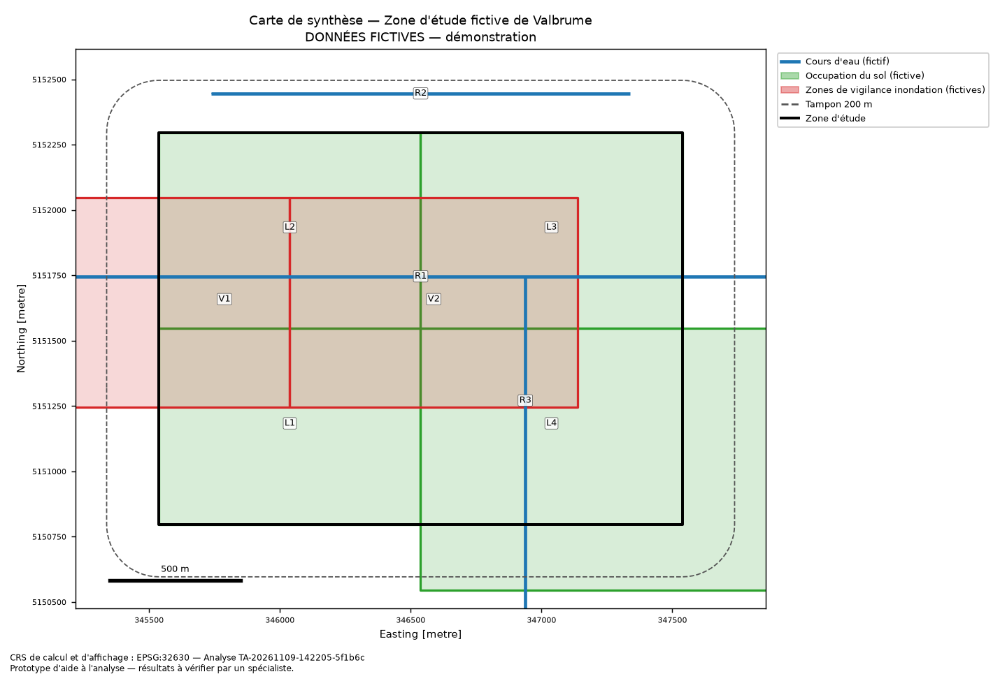
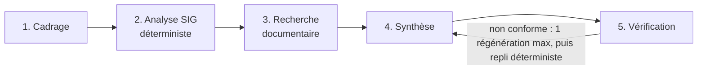

# Assistant multi-agents pour l'analyse préliminaire des contraintes territoriales

[](https://github.com/tagne200/territory-multi-agent/actions/workflows/ci.yml)


> **Prototype d'aide à l'analyse — résultats à vérifier par un spécialiste.**
> Projet de **portfolio**. L'outil ne prend aucune décision réglementaire ou technique, ne certifie pas
> qu'un projet est autorisé et ne remplace ni un ingénieur, ni un géomaticien, ni l'autorité compétente.



## Sommaire

- [Le problème](#le-problème)
- [Ce que fait le prototype](#ce-que-fait-le-prototype)
- [Démarrage rapide](#démarrage-rapide)
- [Architecture des agents](#architecture-des-agents)
- [Formats acceptés](#formats-acceptés)
- [Sources de données et licences](#sources-de-données-et-licences)
- [Mode LLM (facultatif)](#mode-llm-facultatif)
- [Exemples d'entrée et de sortie](#exemples-dentrée-et-de-sortie)
- [Tests et évaluation](#tests-et-évaluation)
- [Limites](#limites)
- [Sécurité et validation humaine](#sécurité-et-validation-humaine)
- [Documentation](#documentation)

## Le problème

Avant une étude d'aménagement ou de gestion de l'eau, une équipe d'ingénierie territoriale doit
inventorier ce qui, dans la zone, mérite une vérification : cours d'eau, zones inondables ou de
vigilance, occupation du sol, documents de référence. Ce travail préliminaire est répétitif. Il est
aussi exposé à deux erreurs : oublier une couche, ou présenter une simple intersection comme une
conclusion.

## Ce que fait le prototype

À partir d'une **zone d'étude** (GeoJSON ou GeoPackage), de **couches SIG**, de **documents locaux**
et d'une **question**, il produit une synthèse traçable. Elle comprend :

1. les **éléments géographiques calculés** (intersections, longueurs, surfaces, parts de zone,
   proximité), avec unité et CRS de calcul ;
2. les **extraits documentaires** verbatim, avec fichier, section ou page ;
3. les **données manquantes**, puis les **limites et incertitudes** ;
4. les **points à vérifier** et les **vérifications humaines recommandées** ;
5. le **registre des sources** : provenance, date, licence, CRS, empreinte, traitements appliqués.

Les livrables sont `report.json`, `report.md`, une carte `map.png` et `findings.geojson`, ce dernier
pouvant s'ouvrir dans QGIS. Chaque constat renvoie à sa source et à l'entité concernée, ainsi qu'à
l'opération effectuée et à la transformation de CRS appliquée.

## Démarrage rapide

Prérequis : Python ≥ 3.11 (GDAL est fourni par les roues de `pyogrio`). Aucune clé API n'est requise.

```bash
git clone https://github.com/tagne200/territory-multi-agent.git
cd territory-multi-agent
python -m venv .venv
# Windows : .venv\Scripts\activate      Linux/macOS : source .venv/bin/activate
pip install -e ".[dev,ui]"

territory-assistant demo                                   # scénario fictif, mode sans LLM
pytest                                                     # 69 tests
territory-assistant evaluate                               # 6 cas d'évaluation
streamlit run src/territory_assistant/ui/streamlit_app.py  # interface web
```

Sortie de `demo` (extrait réel) :

```
[1] Agent 1 — Cadrage de la demande : ok — 0 information(s) manquante(s), 0 blocage(s)
[2] Agent 2 — Analyse SIG : ok — 3 couche(s), 9 constat(s)
[3] Agent 3 — Recherche documentaire : warning — 3 document(s), 8 extrait(s)
[4] Agent 4 — Synthèse territoriale : ok — 24 affirmation(s), résumé par rules
[5] Agent 5 — Vérification critique : ok — statut : à vérifier
Analyse TA-… — statut : à vérifier — mode : sans LLM (déterministe)
```

Le statut « à vérifier » est attendu. La couche de vigilance fictive date de 2019, porte le statut
« provisoire » et a été saisie au 1/25 000. Une licence n'est pas renseignée. Et un document contient
volontairement une tentative d'injection.

Pour analyser vos propres données :

```bash
territory-assistant analyze --area zone.geojson --layers couches/ --docs documents/ \
  --question "Quels éléments territoriaux doivent être examinés ?" --project-type "aménagement" \
  --metric-crs EPSG:2154
```

Installation détaillée : [docs/installation.md](docs/installation.md). Toutes les options :
[docs/user_guide.md](docs/user_guide.md).

## Architecture des agents



| Agent | Rôle | Utilise un LLM ? |
|---|---|---|
| 1. Cadrage | reformule la question, valide les entrées, liste les informations manquantes | facultatif (reformulation seule) |
| 2. Analyse SIG | CRS, réparation des géométries, intersections, mesures, proximité | **jamais** |
| 3. Recherche documentaire | extraits verbatim (BM25 local), signalement des injections | **jamais** |
| 4. Synthèse | sépare faits calculés, contenus documentaires, interprétations et données manquantes | facultatif (interprétations et résumé seulement) |
| 5. Vérification | sources, références, extraits verbatim, chiffres, langage décisionnel, qualité des données | **jamais** |

Principes :

- **Le LLM ne calcule rien et n'a aucun outil.** Les faits chiffrés et les citations sont écrits par
  des règles.
- **Le LLM est vérifié.** Chaque nombre qu'il écrit est comparé aux métriques SIG. Ses sources sont
  *dérivées* des identifiants qu'il cite, jamais reprises de sa réponse.
- **Les documents sont des données.** Un passage ressemblant à une instruction est signalé et exclu
  du LLM.
- **L'orchestration est explicite.** L'ordre est fixe, chaque étape est tracée, et la boucle de
  régénération est bornée.

Détails (prompts système, schémas de validation, erreurs, tests de chaque agent) :
[docs/architecture.md](docs/architecture.md).

## Formats acceptés

| Entrée | Formats | Remarques |
|---|---|---|
| Zone d'étude | GeoJSON, GeoPackage | polygone(s) ; CRS obligatoire ; ≤ 100 km² par défaut |
| Couches | GeoJSON, GeoPackage | CRS obligatoire (GeoJSON sans `crs` = WGS84 selon la RFC 7946, signalé) |
| Documents | `.md`, `.txt` (UTF-8), `.pdf` (texte extractible) | pas d'OCR |
| Métadonnées | `<fichier>.meta.json` | thème, provenance, date, licence, échelle, statut, attributs attendus |

Référence complète, y compris la structure du rapport et les identifiants :
[docs/data_formats.md](docs/data_formats.md).

## Sources de données et licences

- Les données de [`data/sample/`](data/sample) sont **entièrement fictives** (CC0-1.0), générées par
  [`scripts/generate_sample_data.py`](scripts/generate_sample_data.py). Elles sont placées
  volontairement **en mer** pour éviter toute confusion avec un territoire réel. Les valeurs
  attendues sont analytiques : 2 000 m, 40 ha, 13,33 %, etc.
- Le dépôt ne contient ni ne télécharge **aucune donnée réelle**. La procédure pour vérifier la
  source, la date, la licence et le CRS d'une donnée ouverte est décrite dans
  [docs/data_sources.md](docs/data_sources.md).
- Code sous licence MIT ([LICENSE](LICENSE)).

## Mode LLM (facultatif)

```bash
pip install -e ".[llm]"
cp .env.example .env     # puis : TA_LLM_PROVIDER=anthropic et ANTHROPIC_API_KEY=...  (jamais versionné)
territory-assistant demo --llm anthropic
```

- Modèle par défaut : `claude-opus-5-5`. La sortie est contrainte par JSON Schema, puis revalidée par
  Pydantic.
- Les erreurs (clé, quota, délai, indisponibilité, refus, sortie hors schéma) ne bloquent jamais
  l'analyse : elle continue sans LLM, et le rapport l'indique.
- Un fallback serveur en cas de refus du modèle (beta Anthropic) est activé par défaut. On le
  désactive avec `TA_LLM_SERVER_FALLBACK=false`.
- ⚠️ Ce mode n'a pas été exécuté contre l'API réelle pendant le développement. Il est testé avec un
  client simulé.

Toutes les variables : [docs/configuration.md](docs/configuration.md).

## Exemples d'entrée et de sortie

| Élément | Fichier |
|---|---|
| Entrées fictives | [`data/sample/`](data/sample) |
| Rapport JSON généré par le système | [`examples/demo_valbrume/report.json`](examples/demo_valbrume/report.json) — [schéma](docs/report_schema.json) |
| Rapport Markdown | [`examples/demo_valbrume/report.md`](examples/demo_valbrume/report.md) |
| Constats géographiques | [`examples/demo_valbrume/findings.geojson`](examples/demo_valbrume/findings.geojson) |
| Résultats d'évaluation | [`examples/evaluation_results.json`](examples/evaluation_results.json) |

Extrait d'un constat :

```json
{
  "finding_id": "F-L03-001",
  "source_id": "layer:zones_vigilance_fictives",
  "feature_id": "V1",
  "relation": "intersects",
  "metrics": [
    {"name": "surface_dans_zone", "value": 400000.0, "unit": "m²", "crs": "EPSG:32630"},
    {"name": "part_de_la_zone", "value": 13.33, "unit": "%", "crs": "EPSG:32630"}
  ],
  "operation": "intersection(entité, zone) puis aire (m²)",
  "crs_transformation": "EPSG:2154 → EPSG:32630 (GeoPandas.to_crs / PyProj)"
}
```

Comment reconnaître la nature de chaque information dans le rapport :

| Nature | Champ | Marquage |
|---|---|---|
| Données d'exemple fictives | `sources[].is_fictitious` | `true` |
| Résultats de calcul | `spatial_findings`, `statements` de catégorie `computed_fact` | `generated_by: "rules"` |
| Éléments présents dans les documents | `document_evidence`, `statements` de catégorie `document_content` | vérifiés mot pour mot |
| Texte généré par le modèle | `summary`, `statements` de catégorie `interpretation`, `points_to_verify` | `generated_by: "llm"` |
| Recommandations à valider | `points_to_verify`, `human_verifications` | `"à valider par un spécialiste"` |

## Tests et évaluation

```bash
pytest                         # 69 tests, sans clé API ni réseau
ruff check src tests scripts
territory-assistant evaluate
```

Les tests couvrent :
- **SIG** : intersection connue, absence d'intersection, géométrie invalide, CRS absent, reprojection
  avant calcul, couche vide, attributs absents, fichiers corrompus.
- **Documents et agents** : extrait référencé, absence de résultat, affirmation sans source,
  injection, sortie LLM invalide, erreurs LLM, mode sans LLM.
- **Bout en bout** : scénario complet, zone inconnue, couche manquante, erreur de lecture,
  conformité au schéma, références présentes dans le registre, CLI, Streamlit.

Les 6 cas d'évaluation réussissent tous (traçabilité 1,00, précision et rappel SIG 1,00, aucun faux
positif). Ces résultats portent sur des données fictives. **Aucun taux de fiabilité général n'est
revendiqué.** Mesures, résultats et limite mesurée (précision documentaire) :
[docs/evaluation.md](docs/evaluation.md).

## Limites

- Les données de démonstration sont fictives, et le mode LLM n'a pas été testé contre l'API réelle.
- La recherche documentaire est lexicale (pas de synonymes) et ne lit pas les PDF scannés.
- Les contrôles des chiffres et du langage décisionnel reposent sur des règles, qui ont des angles
  morts documentés.
- La précision des résultats ne peut pas dépasser celle des couches d'entrée.

Détail : [docs/limitations.md](docs/limitations.md).

## Sécurité et validation humaine

Protections mises en place :
- chemins limités aux répertoires autorisés ;
- liste blanche des extensions ;
- limites de taille et de nombre d'entités ;
- refus des CRS absents ou incohérents ;
- signalement des géométries réparées ;
- sorties LLM sous schéma ;
- détection et exclusion des injections ;
- aucune clé dans le dépôt.

Chaque rapport se termine par un avertissement d'usage non décisionnel, et chaque recommandation est
marquée « à valider par un spécialiste ». Voir [docs/security.md](docs/security.md).

## Documentation

| | |
|---|---|
| [Index de la documentation](docs/README.md) | point d'entrée |
| [Installation](docs/installation.md) · [Guide d'utilisation](docs/user_guide.md) · [Configuration](docs/configuration.md) | utiliser |
| [Formats de données](docs/data_formats.md) · [Sources de données](docs/data_sources.md) | données |
| [Architecture](docs/architecture.md) · [Sécurité](docs/security.md) · [Limites](docs/limitations.md) · [Évaluation](docs/evaluation.md) | comprendre |
| [Guide développeur](docs/developer_guide.md) · [Contribuer](CONTRIBUTING.md) · [Historique](CHANGELOG.md) · [Kanban](docs/kanban.md) | contribuer |
| [Support de présentation](docs/presentation.md) | présenter le projet |
