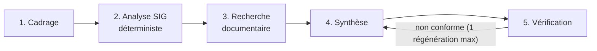

# Assistant multi-agents pour l'analyse préliminaire des contraintes territoriales

[](https://github.com/tagne200/territory-multi-agent/actions/workflows/ci.yml)

> **Prototype d'aide à l'analyse — résultats à vérifier par un spécialiste.**
> Projet de **portfolio**. L'outil ne prend aucune décision réglementaire ou technique, ne certifie pas
> qu'un projet est autorisé et ne remplace ni un ingénieur, ni un géomaticien, ni l'autorité compétente.


## Le problème

Avant une étude d'aménagement ou de gestion de l'eau, une équipe d'ingénierie territoriale doit
inventorier ce qui, dans la zone, mérite une vérification : cours d'eau, zones inondables ou de
vigilance, occupation du sol, documents de référence. Ce travail préliminaire est répétitif. Il est
aussi exposé à deux erreurs : oublier une couche, ou présenter une intersection comme une conclusion.

Le prototype prend en entrée une **zone d'étude**, des **couches SIG** et des **documents locaux**, puis
produit une **synthèse traçable**. Elle contient :
- les éléments géographiques calculés ;
- les extraits documentaires ;
- les points à vérifier ;
- les données manquantes ;
- les incertitudes ;
- les vérifications humaines recommandées.

Chaque constat renvoie à sa source, à l'entité ou à la section d'origine, à l'opération effectuée et à
la transformation de CRS appliquée.

## Architecture des agents



| Agent | Rôle | LLM ? |
|---|---|---|
| 1. Cadrage | reformule la question, valide les entrées, liste les informations manquantes | facultatif (reformulation seule) |
| 2. Analyse SIG | CRS, réparation des géométries, intersections, longueurs, surfaces, proximité | **jamais** |
| 3. Recherche documentaire | extraits verbatim (BM25) avec fichier, section ou page ; signalement des injections | **jamais** |
| 4. Synthèse | sépare faits calculés / documents / interprétations / données manquantes | facultatif (interprétations seules) |
| 5. Vérification | sources, références, extraits verbatim, chiffres, langage décisionnel, qualité des données | **jamais** |

Le LLM ne reçoit aucun outil. Il ne produit ni chiffre ni citation non vérifiés : chaque nombre qu'il
écrit est comparé aux métriques SIG, et ses `source_ids` sont dérivés des identifiants qu'il cite.
Détails, prompts système, schémas et erreurs par agent : [docs/architecture.md](docs/architecture.md).

## Formats acceptés

| Entrée | Formats | Remarques |
|---|---|---|
| Zone d'étude | GeoJSON, GeoPackage | polygone(s) ; plusieurs entités sont fusionnées |
| Couches | GeoJSON, GeoPackage | CRS obligatoire (GeoJSON sans `crs` = WGS84 selon la RFC 7946) |
| Documents | `.md`, `.txt` (UTF-8), `.pdf` (texte extractible) | pas d'OCR |
| Métadonnées | `<fichier>.meta.json` à côté de chaque fichier | nom, thème, provenance, date, licence, échelle, statut… |

## Sources de données et licences

Les données de `data/sample/` sont **entièrement fictives** (CC0-1.0). Elles sont générées par
`scripts/generate_sample_data.py` et placées volontairement **en mer** pour éviter toute confusion
avec un territoire réel. Le dépôt ne contient ni ne télécharge aucune donnée réelle. La marche à
suivre pour vérifier la source, la date, la licence et le CRS d'une donnée ouverte est décrite dans
[docs/data_sources.md](docs/data_sources.md).

Code sous licence MIT ([LICENSE](LICENSE)).

## Installation

Prérequis : Python ≥ 3.11 (testé localement avec Python 3.14 sous Windows ; en CI avec 3.11 et 3.13 sous Ubuntu).

```bash
git clone https://github.com/tagne200/territory-multi-agent.git
cd territory-multi-agent
python -m venv .venv
# Windows : .venv\Scripts\activate      Linux/macOS : source .venv/bin/activate
pip install -e ".[dev]"            # cœur + tests
pip install -e ".[dev,llm,ui]"     # + mode LLM (SDK anthropic) + interface Streamlit
```

## Lancement en mode sans LLM (par défaut, aucune clé)

```bash
territory-assistant demo
```

Sortie attendue (extrait réel) :

```
[1] Agent 1 — Cadrage de la demande : ok — 0 information(s) manquante(s), 0 blocage(s)
[2] Agent 2 — Analyse SIG : ok — 3 couche(s), 9 constat(s)
[3] Agent 3 — Recherche documentaire : warning — 3 document(s), 8 extrait(s)
[4] Agent 4 — Synthèse territoriale : ok — 24 affirmation(s), résumé par rules
[5] Agent 5 — Vérification critique : ok — statut : à vérifier
Analyse TA-… — statut : à vérifier — mode : sans LLM (déterministe)
  map       -> reports/TA-…/map.png
  findings  -> reports/TA-…/findings.geojson
  json      -> reports/TA-…/report.json
  markdown  -> reports/TA-…/report.md
```

Le statut « à vérifier » est attendu : la couche de vigilance fictive date de 2019, son statut est
« provisoire » et son échelle est le 1/25 000, et une licence n'est pas renseignée.

Analyse de vos propres fichiers :

```bash
territory-assistant analyze --area chemin/zone.geojson --layers chemin/couches/ --docs chemin/documents/ \
  --question "Quels éléments territoriaux doivent être examinés ?" --project-type "aménagement" \
  --metric-crs EPSG:2154 --buffer 200
```

Interface web :

```bash
streamlit run src/territory_assistant/ui/streamlit_app.py
```

## Mode LLM (facultatif)

1. `pip install -e ".[llm]"`
2. Copier `.env.example` en `.env` (fichier ignoré par Git), puis définir `TA_LLM_PROVIDER=anthropic`
   et `ANTHROPIC_API_KEY=…`. On peut aussi exporter ces variables dans le terminal. **Ne jamais
   versionner de clé.**
3. `territory-assistant demo --llm anthropic`

Modèle par défaut : `claude-opus-5-5` (`TA_LLM_MODEL`). La sortie est contrainte par JSON Schema
(`output_config.format`), puis revalidée par Pydantic. Les erreurs de clé, de quota, de délai,
d'indisponibilité, de refus ou de sortie hors schéma ne bloquent jamais l'analyse : elle continue en
mode déterministe, et le rapport l'indique. Un fallback serveur en cas de refus du modèle (beta
Anthropic) est activé par défaut et se désactive avec `TA_LLM_SERVER_FALLBACK=false`.
⚠️ Ce mode n'a pas été exécuté contre l'API réelle pendant le développement (voir les limites).

## Tests et évaluation

```bash
pytest                         # 69 tests, sans clé API ni réseau
ruff check src tests scripts   # qualité du code
territory-assistant evaluate   # 6 cas documentés -> reports/evaluation_results.json
```

Couverture des tests :
- **SIG** : intersection connue, absence d'intersection, géométrie invalide, CRS absent, reprojection
  avant calcul, couche vide, attributs absents, fichiers corrompus.
- **Documents** : extrait référencé, absence de résultat, injection, documents malformés, PDF paginé.
- **Agents** : affirmation sans source, référence inconnue, chiffre faux, citation altérée, langage
  décisionnel, sortie LLM invalide, erreurs LLM, mode sans LLM.
- **Bout en bout** : scénario complet, zone inconnue, couche manquante, erreur de lecture, conformité
  au schéma, références présentes dans le registre, CLI, Streamlit.

Mesures et résultats réels de l'évaluation : [docs/evaluation.md](docs/evaluation.md). Aucun taux de
fiabilité général n'est revendiqué.

## Exemples d'entrée et de sortie

- Entrée : [`data/sample/`](data/sample)
- Rapport JSON généré par le système : [`examples/demo_valbrume/report.json`](examples/demo_valbrume/report.json)
  ([schéma](docs/report_schema.json))
- Rapport Markdown : [`examples/demo_valbrume/report.md`](examples/demo_valbrume/report.md)
- Constats géographiques : [`examples/demo_valbrume/findings.geojson`](examples/demo_valbrume/findings.geojson)

Extrait d'un constat (JSON) :

```json
{
  "finding_id": "F-L03-001",
  "source_id": "layer:zones_vigilance_fictives",
  "feature_id": "V1",
  "relation": "intersects",
  "metrics": [
    {"name": "surface_dans_zone", "value": 400000.0, "unit": "m²", "crs": "EPSG:32630"},
    {"name": "part_de_la_zone", "value": 13.33, "unit": "%", "crs": "EPSG:32630"}
  ],
  "operation": "intersection(entité, zone) puis aire (m²)",
  "crs_transformation": "EPSG:2154 → EPSG:32630 (GeoPandas.to_crs / PyProj)"
}
```

Ce que contient le rapport et comment le reconnaître :

| Nature | Champ | Marquage |
|---|---|---|
| Données d'exemple fictives | `sources[].is_fictitious` | `true` |
| Résultats de calcul | `spatial_findings`, `statements` de catégorie `computed_fact` | `generated_by: "rules"` |
| Extraits documentaires | `document_evidence` | vérifiés mot pour mot |
| Texte généré par le modèle | `summary`, `statements` de catégorie `interpretation`, `points_to_verify` | `generated_by: "llm"` |
| Recommandations à valider | `points_to_verify`, `human_verifications` | `"à valider par un spécialiste"` |

## Limites

Elles sont résumées ici. Le détail figure dans [docs/limitations.md](docs/limitations.md).
- Les données de démonstration sont fictives.
- La recherche documentaire est lexicale.
- Il n'y a pas d'OCR.
- Le contrôle des chiffres et du langage décisionnel repose sur des règles et a des angles morts.
- Le mode LLM n'a pas été testé contre l'API réelle.
- La précision des résultats ne peut pas dépasser celle des couches d'entrée.

## Sécurité et validation humaine

Le prototype est protégé contre :
- les fichiers trop volumineux, vides, corrompus ou d'un format inattendu ;
- les chemins hors des répertoires autorisés ;
- les CRS absents ou incohérents ;
- les géométries vides ou invalides ;
- les sorties LLM hors schéma ;
- les instructions malveillantes dans les documents, qui sont traitées comme des données.

Chaque rapport se termine par un avertissement d'usage non décisionnel. Chaque recommandation est
marquée « à valider par un spécialiste ».

## Organisation

Le Kanban proposé et les critères d'acceptation sont dans [docs/kanban.md](docs/kanban.md).
